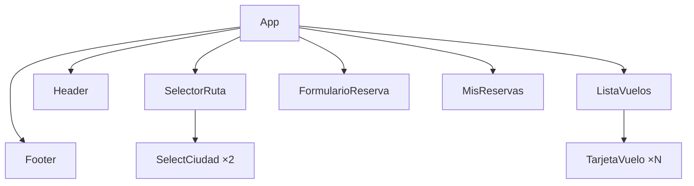

# AeroCol — Reserva tu vuelo

## Proyecto Final

AeroCol deja buscar vuelos por ruta, ordenarlos y elegir uno para reservar. El precio se actualiza según los pasajeros y la clase. Las reservas se guardan en el navegador y se pueden eliminar.

**Sobre esta copia:** no se adjuntó el proyecto de la semana 14. La búsqueda y sus componentes se reconstruyeron a partir del enunciado. Se incluyeron seis vuelos de práctica y se conservó el ejemplo conocido de Medellín a Bogotá (vuelo v4). Si tienes el proyecto de clase, usa ese código para el primer commit e integra encima los cambios de esta copia. No presentes la reconstrucción como el código original de clase.

### Árbol de componentes



Las props están descritas en [el análisis de la Fase 1](docs/fase-1.md).

### F1 — Formulario de reserva

- **¿Dónde viven los estados?** El nombre, la cantidad y la clase viven en `FormularioReserva`. Son datos que se están editando y que el resto de la app no necesita hasta que se confirma la reserva.
- **¿Por qué no hay un estado para el total?** Sale del precio del vuelo, la cantidad y el factor de clase. Al calcularlo en cada render se actualiza al momento. Una vez confirmada la reserva sí guardo el monto dentro de su registro, para conservar el precio que se mostró al reservar.
- **¿Qué prop agregué a la tarjeta?** `onSeleccionar` permite que la tarjeta le avise a `App` qué vuelo se eligió. `seleccionada` le indica si debe marcarse.

### F2 — Mis reservas

- **¿Por qué no usar `push`?** Modifica el array anterior. Si React recibe la misma referencia puede saltarse la actualización. Uso spread para agregar y `filter` para eliminar, así en ambos casos queda un array nuevo.
- **¿Qué pasa al recargar sin `localStorage`?** Se pierde lo que estaba en memoria. Con `JSON.stringify` lo guardo como texto y con `JSON.parse` reconstruyo el array.
- **¿Dónde guardo?** En `App` uso una función inicializadora para recuperar las reservas al empezar. Un `useEffect` guarda el array cada vez que cambia. `MisReservas` solo lo muestra y pide eliminar por ID.

### F3 — Catálogo inteligente

- **¿Por qué ordenar una copia?** Porque `sort` cambia el array sobre el que se ejecuta. Ordeno una copia de los resultados para que la lista original no cambie. Comparo precios con restas y horas o nombres con `localeCompare`. Las horas vienen en formato de 24 horas con dos dígitos.
- **¿Qué pasa al cambiar de ruta?** Se mantiene el criterio de orden. Al cambiar el origen o destino, solo se limpia la selección de vuelo. También se borra el destino si coincide con el nuevo origen.
- **¿Cómo se comunica la tarjeta con `App`?** La tarjeta llama a `onSeleccionar(vuelo)` al pulsarla. `App` guarda el vuelo, resalta su tarjeta y muestra el formulario con avión, hora y precio.

### Decisión de diseño

Dejé el vuelo seleccionado en `App` porque lo necesitan tanto la lista para resaltar la tarjeta como el formulario para mostrar el detalle. Si lo guardara dentro de cada tarjeta, tendría que sincronizar varias selecciones. En cambio, los datos que todavía estoy escribiendo se quedan en el formulario. Usé el ID del vuelo como `key` del formulario para que no se arrastren esos datos al elegir otro.

### Cómo correrlo

Se recomienda Node.js 22. Desde la carpeta del proyecto ejecuta:

```bash
npm install
npm run dev
```

`npm install` solo es necesario la primera vez o si cambian las dependencias. Abre la dirección que imprima Vite en la terminal. Los vuelos y precios son de práctica y no hay cobro ni conexión a una aerolínea.

### Verificación

```bash
npm run lint
npm run build
```

- Prueba Bogotá → Medellín para ver tres vuelos y verificar las cuatro opciones de orden.
- Prueba Medellín → Bogotá. Selecciona ATR 72, agrega un pasajero y cambia a Ejecutiva. El total debe ser **$ 832.000 COP**. Sin nombre el botón debe seguir deshabilitado.
- Escribe un nombre, reserva, recarga la página y revisa que la reserva con fecha siga ahí. Bórrala y revisa el estado vacío. Cambia de ruta y verifica que el criterio de orden no cambie.

Para ensayar la demo, consulta [las notas para la defensa](docs/defensa.md).

Si vas a unir esta solución a la base de clase, revisa [los pasos de integración](docs/integracion.md).
