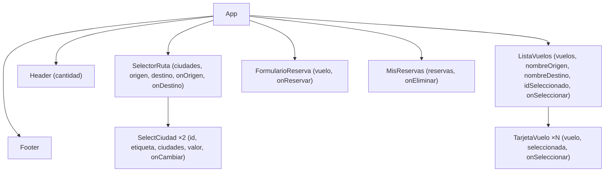

# Fase 1 — Análisis de AeroCol

1. **¿Dónde viven origen y destino?** En `App`. La búsqueda necesita los dos valores juntos y los comparte con el selector y la lista. Si cada `SelectCiudad` guardara su valor por separado, sería más difícil filtrar los vuelos y evitar que origen y destino sean iguales.
2. **¿Qué más necesita recibir ListaVuelos?** La función `onSeleccionar` para pasársela a cada tarjeta y `idSeleccionado` para saber cuál marcar.
3. **¿Qué guarda una reserva?** Un objeto `{ id, nombre, vuelo, pasajeros, clase, total, fecha }`. El campo `vuelo` guarda el ID del vuelo. `fecha` es la fecha y hora en que se hizo la reserva, no la fecha de viaje.
4. **¿Dónde viven las reservas?** En `App`, porque ahí se reciben los datos del formulario y desde ahí se manda la lista a `MisReservas` y el contador a `Header`.

## Árbol de componentes y props

El formulario cuelga de `App` y se muestra solo cuando hay un vuelo elegido. El selector de orden es un elemento de `App` y no un componente separado.
